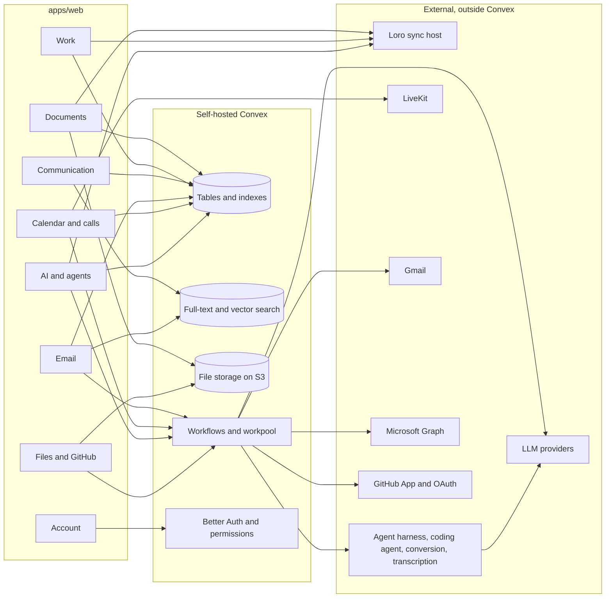

# Feature graph

Per domain, each file maps the features in the [feature map](../feature-map/README.md)
to the frontend code, API calls, Rust services, Postgres tables, realtime channel and
external systems they depend on today, with the Convex v1 scope. Use it to scope a
domain before porting it; the Rust side is a reference, not a target.

## Scope per domain

| Domain | Features | `v1` | `v1-integration` | `later` | `drop?` |
| --- | --- | --- | --- | --- | --- |
| [Account](account.md) | 10 | 5 | 1 | 2 | 2 |
| [Documents](documents.md) | 10 | 7 | 0 | 3 | 0 |
| [Work](work.md) | 8 | 6 | 2 | 0 | 0 |
| [Communication](communication.md) | 10 | 8 | 0 | 2 | 0 |
| [Email](email.md) | 8 | 0 | 7 | 1 | 0 |
| [Calendar and calls](calendar.md) | 10 | 3 | 3 | 4 | 0 |
| [AI and agents](ai.md) | 11 | 7 | 1 | 2 | 1 |
| [Files and integrations](integrations.md) | 10 | 2 | 6 | 2 | 0 |
| **Total** | **77** | **38** | **20** | **16** | **3** |

## Cross-domain shape

## Cross-cutting decisions to make first

1. **Loro sync host.** Markdown, canvas, DOCX, forms, project descriptions and
   AI edit all run on Loro CRDTs through sync-service; Convex has no equivalent.
   Choose between keeping one external Loro sync host that persists snapshots to
   Convex file storage, or rebuilding these editors on Convex writes.
2. **Soup and live lists.** Home, email lists and live lists depend on GraphQL
   shapes, a server-side predicate index and Done/Undo receipts. Decide whether
   Convex queries reproduce those shapes or the frontend list layer moves to
   Convex queries.
3. **Identity.** FusionAuth covers passwordless codes, Google and Apple sign-in,
   sessions and refresh; Gmail, Outlook and GitHub need their own OAuth grants.
   Map both to Better Auth with organizations, plus custom invite links and
   auto-join where its plugin falls short.
4. **Sync jobs.** Gmail history IDs, Outlook delta tokens, calendar push and the
   GitHub App webhooks become `@convex-dev/workflow` runs over cursors, with
   idempotent sends.
5. **External workers.** The agent turn loop, Daytona sandboxes, code-mode runner,
   document conversion, transcription and LiveKit stay outside Convex; a workflow
   starts them and they report back through HTTP actions.
6. **`macro` CLI.** It uses the folder-level projects endpoints while the
   Projects UI uses initiatives; the Convex API must serve the CLI (see
   [work](work.md)).

Each domain file lists its own open questions.
