# Account feature graph

One row per feature file in `docs/convex/feature-map/account/`. Frontend paths are under `apps/web/src/features/` unless stated. API calls name the auth-service client methods (`apps/web/src/lib/service-clients/service-auth/client.ts`) and the HTTP paths they hit. Tables are Postgres tables from `crates/macro_db_client/migrations/`. Anything not seen in code is marked `(unverified)`.

| Feature | Frontend (apps/web/src/...) | API calls | Rust service(s) | Main Postgres tables | Realtime | External systems | Convex v1 scope |
| --- | --- | --- | --- | --- | --- | --- | --- |
| login-and-signup | `features/auth/`, `features/mobile-onboarding/MobileAuthWelcome.tsx`, `features/gtm-invite/`, `routes/use-sync-login-cookie.ts` | `POST /login/passwordless`, `POST /login/password` (one allowlisted address), `POST /login/apple`, `GET /login/sso`, `POST /session/login/{code}`, `GET /user/me`, token refresh (client method `refreshToken`), `POST /logout`, `GET /user/link_exists`, `POST /webhooks/user/*` (FusionAuth user webhooks, exact path unverified) | `services/authentication_service` (login, session, jwt, user, webhooks, gtm-invite, signup_policy) | `macro_user`, `macro_user_info`, `macro_user_email_verification`, `in_progress_user_link`, `GtmInviteLink` / `gtm_invite_link` | none observed | FusionAuth (identity, passwordless codes), Google OAuth, Apple sign-in (iOS), email delivery for codes (unverified provider), Redis rate limits (`macro_redis`) | v1 |
| onboarding | `features/onboarding/`, `features/mobile-onboarding/`, `queries/auth/tutorial`, `queries/auth/user-info`, `queries/gtm-invite/links`, `queries/mcp-servers`, `queries/pipedream-connectors` | `PATCH /user/onboarding`, `PATCH /user/tutorial`, `GET /user/organization`, `POST /team`, `POST /team/invite`, `GET /user/stripe/trial_eligibility`, `POST /user/stripe/checkoutv2`, `GET /onboarding/prompts` | `services/authentication_service` (user, team, stripe, `crates/onboarding` router) | `user_onboarding`, `macro_user_info` (tutorial state), `team`, `team_user`, `team_invite` | none | Google (work and personal accounts), Pipedream (tool catalog, unverified service), Stripe (plan checkout), GitHub (link) | v1 (plan and tools steps can be `later`) |
| teams-and-invitations | `features/settings/` (Team, TeamGeneral, TeamMembers, TeamInviteLinkSection, team-invite-row), `features/team-invitations/`, `features/settings/components/billing-*` (seat plan) | Under `/team` (methods per route in the team router): `/user`, `/user/invites`, `/` (get, create, patch, delete), `/invites`, `/invite`, `/invite/{id}`, `/join/{id}` (join and reject), `/remove/{id}`, `/members/{id}/plan`, `/invite-link` (create, get, delete), `/invite-link/team`, `/invite-link/join`, `/auto-join-domain/toggle`, `/non-admin-invites/toggle`, `/crm` | `services/authentication_service` (nests `/team`; `crates/teams`) | `team`, `team_user`, `team_invite`, `team_invite_link`, `team_crm_settings`, `team_joined_macro_email` | none observed | Email (invites and reminders, provider unverified), Stripe (seat billing) | v1 |
| settings-and-account | `features/settings/` (Settings, Account, Notifications, Shortcuts, Tags, DesktopApp, MobileApp, MobileSettings*, MutedItemRow), `lib/core/constant/settingsTabsConfig.tsx` | `GET /user/me`, `GET|PUT /user/name`, `POST /user/profile_pictures`, `PUT /user/profile_picture`, `DELETE /user/me`, `POST /user/get_names`, notification and snooze endpoints (unverified path), tag endpoints (unverified path) | `services/authentication_service` (user, delete_user); `services/notification_service`; tags via `crates/properties` (service unverified) | `macro_user_info`, `user_notification`, `user_mute_notification`, `user_notification_type_preference`, `notification_user_device_registration`, properties tables (unverified) | none observed | FusionAuth (account delete, `delete_user` guards it), S3 via `document-storage-service` (profile pictures), push device registration (APNs, FCM, web push; unverified) | v1 |
| connections-and-integrations | `features/settings/` (Email, email-settings, SignatureEditor, SignatureSection, IntegrationsPage, GitHub, Granola, TeamConnections, connections/*, slack-channel-import/*), `queries/pipedream-connectors`, `queries/mcp-servers` | `POST /link/gmail`, `GET /link/gmail/status`, `POST /link/outlook`, `GET /link/email/providers`, `POST /link/github`, `DELETE /link/github`, `GET /link/github/status`, `POST /link/` (in-progress link), `GET /github_pull_requests/*`, email settings endpoints (unverified path), Pipedream connect and MCP catalog (unverified path), Slack import job endpoints (unverified path) | `services/authentication_service` (link, oauth2, oauth); `services/email_service`; `services/connection_gateway` (Pipedream, unverified); `services/mcp_auth_proxy` (custom MCP OAuth, per its README); `services/slack_import_worker` | `in_progress_user_link`, `in_progress_email_link`, `email_links`, `email_link_google_scopes`, `email_link_microsoft_scopes`, `microsoft_link_attempts`, `email_link_initializations`, `email_provider_subscriptions`, `email_mailbox_watch_work`, `email_settings`, `github_links`, `github_app_installation_team` | none observed for connect flow; inbox sync (unverified) | Gmail API, Microsoft Graph (Outlook), GitHub OAuth and GitHub App, Pipedream, Slack, Granola (unverified), S3 (Slack archive staging, unverified) | v1-integration |
| agents-and-developer-settings | `features/settings/` (Agents, AgentSettings, Harness, Bots, BotSettingsList, ApiKeys, Agent, CursorConnectPage, codex/*, RuntimePairingPage, LocalRuntimeCard), `features/block-agent/` (agent surfaces, other domain) | `GET|PUT|DELETE /cursor-api-key`, `GET /cursor-api-key/models`, `PUT /cursor-api-key/default-model`, `GET|PUT|DELETE /agents/{agent_id}/api-key` (agent API key), `GET|DELETE /codex`, `POST /codex/login`, `GET|DELETE /codex/login/{id}`, `GET /codex/environments`, `PUT /codex/config`, bot and harness endpoints (SDK `bots`, `harnesses`, `api-keys` entities) | `services/authentication_service` (cursor_api_key, agent_api_keys, codex); `services/agent_harness_service`; `services/bots`; `services/agent_trigger_service` (routines, unverified) | `cursor_api_keys`, `agent_api_keys`, `UserApiKey`, `user_agent_coding_preferences`, `user_agent_sandbox_size`, harness and bot tables (unverified names) | agent session streaming (unverified) | Cursor API, OpenAI/ChatGPT device sign-in (Codex), GitHub (cloud environments), LLM providers (Anthropic, OpenAI) | later |
| billing-usage-and-paywall | `features/settings/` (Billing, billing-settings-view, billing-plan-card, current-plan-card, billing-context), `features/usage/`, `features/paywall/`, `features/billing-lab/` (local only), `queries/auth/stripe-checkout`, `queries/auth/ai-billing` | AI billing summary, plans, overage and auto-reload updates, and AI credit checkout (paths unverified), `GET /user/stripe/trial_eligibility`, `POST /user/stripe/checkoutv2`, `POST /user/stripe/portal`, `POST /user/stripe/plan` (change plan), `GET /user/stripe/plan` (subscription status), `GET /user/quota`, `POST /webhooks/user/stripe_webhook` (Stripe, inbound) | `services/authentication_service` (user/stripe, ai_billing router, webhooks, user_quota, ai_usage) | `ai_billing_account`, `ai_billing_plan_change`, `ai_billing_period_allowance`, `ai_billing_usage_period`, `ai_billing_usage_observation`, `ai_billing_usage_eligibility`, `ai_billing_usage_rollout`, `ai_credit_ledger`, `ai_credit_reload`, `ai_usage`, `ai_usage_observation`, `subscription_plan_schedule`, `macro_user` (trial flag), `OrganizationBilling`, `team` (paying, enterprise) | none observed | Stripe (checkout, portal, webhooks, invoices), LLM providers (usage metering) | drop? |
| appearance-and-theme | `features/theme/`, `features/settings/Appearance.tsx`, `features/settings/components/appearance-mode-picker.tsx`, `features/onboarding/core/workspace-accent.ts` | none (browser local storage only) | none | none | none | none | v1 (client-only, nothing to port) |
| guided-tours-and-setup-prompts | `features/tours/`, `features/tutorial/`, `features/sidebar-promotion/`, `components/app/InitialInteractiveOnboardingModal.tsx`, `features/home/components/HomeSetupPromotion.tsx`, `features/reviews-view/components/RepositoriesPromotion.tsx`, `features/slack-import/slack-import-sidebar.tsx` | `GET /onboarding/prompts`, `POST /onboarding/prompts/{id}/dismiss`, `PATCH /user/tutorial`, PostHog feature flags (`enable-in-app-tours`, `enable-sidebar-promotions`) | `services/authentication_service` (`crates/onboarding` router, unverified mount point beyond auth service) | `user_dismissed_prompt`, `macro_user_info` (tutorial complete) | none | PostHog (flags), YouTube (embedded video, on click only) | later |
| developer-tools-and-ui-gallery | `features/ui-gallery/`, `features/devtools/`, `components/ui/**/*.docs.tsx`, `components/app/split-layout/componentRegistry.tsx` (debug registrations), `routes/routes.ts` (debug routes) | none | none | none | none | none | drop? |

Row count: 10 features. Scope counts: v1 = 5 (login-and-signup, onboarding, teams-and-invitations, settings-and-account, appearance-and-theme), v1-integration = 1 (connections-and-integrations), later = 2 (agents-and-developer-settings, guided-tours-and-setup-prompts), drop? = 2 (billing-usage-and-paywall, developer-tools-and-ui-gallery).

## Diagram

```mermaid
flowchart LR
  subgraph Features
    F1[login-and-signup]
    F2[onboarding]
    F3[teams-and-invitations]
    F4[settings-and-account]
    F5[connections-and-integrations]
    F6[agents-and-developer-settings]
    F7[billing-usage-and-paywall]
    F8[appearance-and-theme]
    F9[guided-tours-and-setup-prompts]
    F10[developer-tools-and-ui-gallery]
  end
  subgraph Services
    S1[authentication_service]
    S2[email_service]
    S3[notification_service]
    S4[connection_gateway]
    S5[mcp_auth_proxy]
    S6[slack_import_worker]
    S7[agent_harness_service]
  end
  subgraph Tables
    T1[(macro_user, macro_user_info)]
    T2[(team, team_user, team_invite, team_invite_link)]
    T3[(user_onboarding)]
    T4[(email_links, email_settings, github_links)]
    T5[(ai_billing_*, ai_credit_*, subscription_plan_schedule)]
    T6[(cursor_api_keys, agent_api_keys, UserApiKey)]
    T7[(user_notification, user_mute_notification)]
    T8[(user_dismissed_prompt)]
  end
  subgraph External
    X1[FusionAuth]
    X2[Google OAuth]
    X3[Apple sign-in]
    X4[Gmail API]
    X5[Microsoft Graph]
    X6[GitHub OAuth and App]
    X7[Stripe]
    X8[Pipedream]
    X9[Slack]
    X10[S3]
    X11[PostHog]
    X12[Cursor and LLM providers]
  end
  F1 --> S1
  F1 --> T1
  F1 --> X1
  F1 --> X2
  F1 --> X3
  F2 --> S1
  F2 --> T3
  F2 --> T1
  F2 --> X7
  F2 --> X8
  F3 --> S1
  F3 --> T2
  F4 --> S1
  F4 --> S3
  F4 --> T1
  F4 --> T7
  F4 --> X1
  F4 --> X10
  F5 --> S1
  F5 --> S2
  F5 --> S4
  F5 --> S5
  F5 --> S6
  F5 --> T4
  F5 --> X4
  F5 --> X5
  F5 --> X6
  F5 --> X8
  F5 --> X9
  F6 --> S1
  F6 --> S7
  F6 --> T6
  F6 --> X12
  F7 --> S1
  F7 --> T5
  F7 --> X7
  F9 --> S1
  F9 --> T8
  F9 --> X11
  F1 --> X11
  F2 --> X11
```

## Convex porting notes

- Identity is the largest change. FusionAuth provides passwordless codes, Google and Apple sign-in, session cookies, and JWT refresh. Better Auth needs an email one-time-code plugin, a Google social provider, an Apple provider for iOS, and a session model that works for the web app and native shells (including the session-code handoff used by hosted-dev and mobile SSO).
- Separate login identity from provider connections. Gmail, Outlook, and GitHub links carry OAuth grants with scopes, refresh tokens, and reauthorization states (`email_link_google_scopes`, `email_link_microsoft_scopes`, `github_links`). Keep these in app tables, not in the login identity, and treat revocation and reconnect as first-class states.
- Team roles map to Better Auth organizations with roles `owner`, `admin`, `member`. Custom pieces: members-can-invite toggle, auto-join by email domain, reusable invite links (reset and turn-off), per-seat plan, and the free-team no-cap rule. Invitations with reminders (3 days, then 4 days, none after 14 days) need scheduled functions.
- Stripe billing is `drop?`. If AI usage limits stay, keep only the allowance counters (`ai_usage`, `ai_billing_period_allowance`) and drop the Stripe paths.
- Profile pictures and signature images are blobs. Use Convex file storage for them, with signed URLs. None approaches the 1 MiB row limit on its own, but never put them in a row.
- Slack archive import reads a large ZIP and writes history in batches. It needs an external worker, not a mutation. Resumable upload and job tracking are required.
- Account deletion cascades into FusionAuth and across data. Put it in an action or external worker with an explicit order. Keep the guard that stops deleting the identity-provider admin account.
- Login-code rate limits are Redis-backed today. Convex needs table-based counters with time windows.
- Realtime: no realtime requirement is visible in this domain. Settings and invites refetch. Snoozes are enforced by the server on expiry, so use scheduled functions, not client timers.
- Theme and tour state are browser-local. Keep them out of the backend. Setup-card dismissals are server state (`user_dismissed_prompt`) and cheap to port.
- The password path for one allowlisted address and the signup allowlist are a security surface. For three users, replace them with an explicit allowlist table and drop the hard-coded password path.
- Mobile-web email signup, GTM invite links, and referral invites are marketing-driven. They are outside the three-user v1 unless the team needs them.

## Open questions

- Is Stripe or any paid plan needed for three users? If not, `billing-usage-and-paywall` becomes `drop?` for the whole stack, including the paywall dialog that gates free features.
- Is Apple sign-in needed? It only matters for iOS builds.
- Are GTM invite links and referral invites needed for v1, or are they marketing-only?
- Which screen is the authoritative first-login landing for desktop users: Home or onboarding? The docs disagree.
- Should `/app/debug/ui` ship on production builds? The route has no environment gate today.
- Does Better Auth's organization plugin cover members-can-invite, auto-join by domain, and reusable invite links, or are these custom tables?
- Which email provider sends login codes and team invitations in v1, and does the local stack need a Mailpit equivalent?
- Keep appearance and theme browser-local, or sync them to the account?
- Is the Slack import needed in v1? It drives a large part of the worker design.
- Which runtime and agent configuration pages must exist for v1 of the agents domain?
