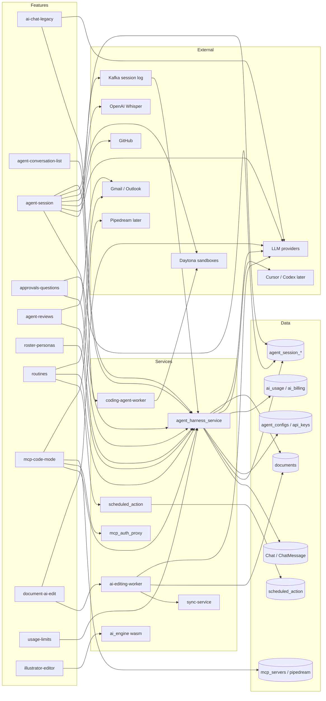

# AI feature graph

Scope: AI chat, Macro's agent sessions, agent questions and approvals, agent reviews, the agent roster and personas, routines, connections and code mode, AI edit in documents, AI usage limits, and the Illustrator file editor (`block-ai`, which is not an AI feature despite its name). Feature files: `docs/convex/feature-map/ai/`.

| Feature | Frontend (apps/web/src/features/) | API calls | Rust service(s) | Main Postgres tables | Realtime | External systems | Convex v1 scope |
| --- | --- | --- | --- | --- | --- | --- | --- |
| ai-chat-legacy | block-agent, agents-view (legacy chat surfaces; exact dir unverified) | `POST /cognition/stream/chat/message`; chat list and read (unverified) | agent_harness_service (cognition module) | `Chat`, `ChatMessage`, `ChatAttachment`, `ChatPermission` | Websocket stream for results (per agent guide) | LLM providers (Anthropic, OpenAI, Gemini), PostHog | v1 |
| agent-conversation-list | agents-view, agent-conversations, agent-activity | SDK `agentSessions` list; `GET /agent-sessions`, `GET /agent-sessions/by-pull-requests` | agent_harness_service | `agent_session`, `agent_conversation_sessions`, `agent_conversation_settings`, `agent_conversation_turns` | Session updates trigger list refetch | GitHub (PR state) | v1 |
| agent-session | block-agent, agent-activity, agent-conversations, agents-view | SDK `agentSessions`; `/agent-sessions/{id}`, `/{id}/log`, `/{id}/queue`, `/{id}/queue/{action}/steer`, `/{id}/control`, `/{id}/name`; `POST /agent-sessions`, `/agent-sessions/warm` | agent_harness_service (with crates agent_session, agent_inmem, agent_harness, agent_changes, agent_egress, agent_preview); coding-agent-worker for coding sessions | `agent_session`, `agent_session_log`, `agent_session_queue`, `agent_session_changes`, `agent_session_pull_request`, `agent_session_notification`, `agent_external_replies` | Kafka `macro.agent_session_log` to agent_session_realtime to GraphQL subscription `agentSessionLogAppended` | LLM providers; Daytona sandboxes (coding); GitHub; OpenAI Whisper (dictation); Cursor and Codex runtimes (later) | v1 (Macro in-app agent); coding runtimes later |
| agent-approvals-and-questions | agent-interactions, block-agent | `/agent-sessions/{id}/permissions`; queue and control routes | agent_harness_service; crates agent_session (tool approval) | `agent_session_tool_approval`, `agent_session_tool_standing_approval` | Session log stream | Notifications (inbox, browser, iOS push); Pipedream (connect-app, later) | v1 (questions, permissions); connect-app later |
| agent-reviews | agent-reviews, block-agent | Session-scoped review and draft routes (unverified) | agent_harness_service; crates agent_session (review) | `agent_session_review` | Session log stream | Gmail, Outlook (MS Graph) | v1-integration |
| agent-roster-and-personas | agents-view (roster), agent-dms, settings Agents page | SDK `agents`; `PUT /auth/agents/{id}/api-key`; direct message get-or-create | agent_harness_service; crates agent_api_keys | `agent_configs`, `agent_api_keys`, `comms_channel_agents` | none | Anthropic and OpenAI (user keys); Cursor and paired runtimes (later) | v1 |
| routines | routines, agents-view | SDK `routines`; routine HTTP routes under agent_harness_service | agent_harness_service (scheduling); crates routines, scheduled_action | `scheduled_action`, `scheduled_action_event_run` | none | LLM providers; Gmail, Outlook (delivery) | v1 |
| mcp-connectors-and-code-mode | block-agent (tool UI), agents-view (Add connections), Settings Integrations (unverified) | Public MCP endpoint (OAuth, `initialize`, `tools/list`, `tools/call`); SDK entities used by code mode | agent_harness_service (public_mcp, code mode); services/mcp_auth_proxy; crates mcp_client, mcp_toolset, pipedream_mcp, agent_code_mode | `mcp_servers`, `agent_mcp_servers`, `pipedream_mcp_connections`, `agent_code_execution` | none | Pipedream (later); FusionAuth (OAuth); Deno runtime per execution; PostHog flags | later |
| document-ai-edit | Document editor (AI edit control in documents feature; exact dir unverified) | `POST /edit` on ai-editing-worker; document token exchange | ai-editing-worker (Cloudflare Worker, TypeScript, not Rust); sync-service (Rust) | Document tables via document service (unverified) | Loro CRDT over sync-service WebSocket | LLM providers (Claude Haiku 4.5, Claude Sonnet 5.5, GPT-5.5 as overrides); Browser (CDP) for canvas edits | v1 |
| ai-usage-limits | Settings Usage (dir unverified), agents-view (dialog) | Usage and quota endpoints (unverified) | agent_harness_service (admission); crates ai_billing, ai_usage | `ai_usage`, `ai_billing_*`, `ai_credit_ledger`, `ai_credit_reload`, `ai_funding_*` | none | Payment provider (unverified) | drop? |
| illustrator-ai-file-editor | block-ai | Static file and document download (unverified) | crates ai_engine (Rust compiled to WebAssembly, runs in the browser) | document file metadata | none | none | later |

## Convex porting notes

- **Long-running agent turns stay external.** A session turn streams for minutes, calls tools and waits on approvals. Keep it in an external worker (the agent_harness_service equivalent) that writes each log frame to Convex; Convex mutations and actions are request/response and cannot hold a stream open.
- **Sandboxes and runtimes stay external.** Daytona sandboxes, the Deno code-mode runner (one process per execution) and the coding-agent container are long-running and must run outside Convex.
- **Session log fan-out.** Kafka plus a GraphQL subscription becomes a reactive Convex query on the session log table. Watch the per-row size and query fan-out; the transcript is append-heavy.
- **Session queue and steer.** Queued prompts, steer and flush are transactional state changes. Model them as Convex mutations with an explicit action ID, and have the external worker claim the next entry.
- **Pauses for approval and questions.** A turn waiting for a user answer must be durable across restarts. Store the pending item in a table and have the worker resume from it; do not rely on an in-memory promise.
- **Routines need a durable scheduler.** Convex scheduled functions can trigger a run, but the run itself is a long agent turn: the trigger is in Convex, the execution is external.
- **Document AI edit is the hardest part.** The worker joins the document as a CRDT peer over a WebSocket and streams keystrokes for minutes. Porting it means either keeping a Loro-compatible sync endpoint or replacing the edit path with Convex-native writes; the choice affects the whole document editor.
- **Large blobs.** Transcript frames, tool results and dictation audio (up to about 8 MB or 5 minutes) must not sit in rows above 1 MiB. Store large payloads in S3-compatible storage and keep references in rows.
- **Search.** Session search and mention lookup need a search index; Convex's built-in search covers titles, not transcript bodies (unverified).
- **Usage metering.** Per-call usage rows are small and fit Convex mutations. Admission checks must run before provider work starts.
- **Provider keys.** Anthropic, OpenAI and Google keys (plus per-agent BYO keys) must be stored as encrypted secrets, not rows. The Codex credentials are KMS-encrypted today (unverified for v1).

## Open questions

1. Is the Macro in-app agent the only v1 runtime? Cursor, Codex and paired macrod runtimes and Daytona coding sessions are assumed `later`.
2. Which LLM providers and models does v1 need (Anthropic, OpenAI, Google Gemini, open-weight models) and whose keys are used? The guide lists Opus 5.5, Sonnet 5.5, Haiku 4.5, GPT-5.6, GPT-6 Astra and Gemini 3.8 Flash.
3. Does the document AI edit keep a Loro-compatible sync path, or is it rebuilt on Convex writes? This decision drives the document editor port.
4. Is AI usage metering and the limit dialog `drop?` for three users, or is an allowance needed for cost control?
5. Is the Illustrator file editor `later` or dropped? It needs no AI backend, only file storage.
6. Are Pipedream connectors and the public workspace MCP v1, or `later`? Code mode is used by agent sessions and would be affected.
7. Should legacy standalone chats be migrated into agent sessions, or kept read-only?
8. Dictation (OpenAI Whisper) and image generation (Google Gemini) appear on every AI composer; confirm they are v1.
9. GitHub pull request review (Changes pane, PR chips) is part of agent sessions; confirm it stays in the GitHub v1 integration.
