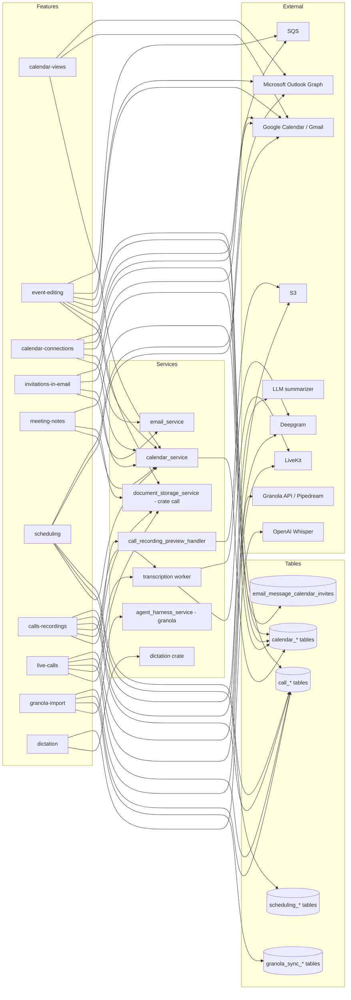

# Calendar feature graph

One row per feature file in `docs/convex/feature-map/calendar/`. Frontend paths are under `apps/web/src/features/` unless noted. Backend names are the Rust services and crates that serve each feature. Rows marked (unverified) were inferred from names or partial reads, not traced end to end.

| Feature | Frontend (apps/web/src/...) | API calls (SDK entity / HTTP) | Rust service(s) | Main Postgres tables | Realtime | External systems | Convex v1 scope |
| --- | --- | --- | --- | --- | --- | --- | --- |
| calendar-views | features/calendar, features/calendar-view, features/block-calendar; lib/queries/calendar (GraphQL cache and sync) | SDK calendar entity (packages/sdk/src/entities/calendar); GraphQL calendar reads (graphql_calendar); REST occurrence reads (paths unverified) | calendar_service; crates calendar_events, graphql_calendar | calendar_events, calendar_event_occurrences, calendar_event_attendees, calendar_event_sources, calendar_accounts, calendars, calendar_change_log, calendar_change_counters | connection-gateway poke (refresh_calendar) plus GraphQL CalendarChanges delta; no CRDT | Google Calendar API; Microsoft Outlook (via sync, host unverified) | v1 |
| event-editing | features/calendar (components/composer, hooks/use-event-editor), features/calendar-view, features/block-calendar | SDK calendar entity (event.ts: update, RSVP, guests, delete, eventIcs); calendar_service mutation and replacement routers | calendar_service; document_storage_service (ICS export); crate call (Macro call creation) | calendar_event_overrides, calendar_event_override_attendees, calendar_event_join_requests, calendar_event_replacements, calendar_sync_outbox, calendar_projection_outbox, calendar_outlook_work, calendar_outlook_members, calendar_outlook_declines, calendar_outlook_away_checks, calendar_event_reminder_deliveries, calendar_event_reminder_firings, call_meetings | connection-gateway poke (refresh_calendar) | Google Calendar API (writes); Microsoft Graph (writes, unverified); SQS reminder dispatch queue | v1-integration |
| calendar-connections | features/calendar (calendar-settings, connected-calendars, hooks/use-calendar-accounts, TurnOffCalendarDialog); features/settings (Settings → Calendar) | SDK calendar namespace (account and calendar calls, unverified names); calendar_service calendar_watch (Google push webhook) and team-settings router | calendar_service; email_service (calendar_refresh) | calendar_accounts, calendars, calendar_backfill_jobs, calendar_team_sharing, calendar_availability_preferences | pubsub (calendar_service pubsub_util); team_sharing_changed push | Google OAuth and Calendar API (calendar.events, calendar.calendarlist.readonly); Google push notifications; Microsoft identity (unverified); SQS backfill queue | v1-integration |
| invitations-in-email | features/email-message (components/calendar-invite-card.tsx; owned by the email domain, card logic here) | email_service calendar-invitation copy route; calendar_service RSVP route (paths per guide) | email_service; calendar_service | email_message_calendar_invites, calendar_accounts, calendar_events | none; card refreshes with thread refresh | Gmail API; Google Calendar; Outlook | v1-integration |
| meeting-notes | features/calendar-notes (calendar-meeting-notes, document-meeting-notes, meeting-reference); Markdown document editor is owned by the document domain | SDK calendar note entity (packages/sdk/src/entities/calendar/note.ts); calendar_service notes router (meeting-note link routes) | calendar_service (crate calendar_events notes); document_storage_service | calendar_event_notes; document and share-access tables (owned by document and entity_access domains, not inspected) | none verified | none | v1 |
| scheduling | features/scheduling (incl. browser-test); routes/public-booking-shell.tsx | calendar_service nests the calendar_scheduling router (paths unverified); no SDK scheduling entity found | calendar_service; crate calendar_scheduling | scheduling_profile, scheduling_booking, scheduling_host_claim, scheduling_public_budget; reads calendar_events and attendees for busy time | none (receipt page polls) | Google Calendar and Outlook (busy time, invitations, Google Meet creation); Macro call via crate call | v1 |
| calls-recordings | features/calls-view (calls-view, call-detail); features/block-call (CallRecording, CallTranscript, sidepanel, incoming-calls) | SDK calls entities (call-record.ts, message.ts); document_storage_service call routes (paths unverified) | document_storage_service (crate call); call_recording_preview_handler; transcription (LiveKit agent); search_processing_service | calls, call_records, call_record_participants, call_record_guests, call_record_transcripts, call_transcripts, call_entities, call_entity_recordings, call_entity_transcripts, call_entity_transcript_segments, call_entity_sources, call_entity_attendance | none verified (lists refresh through soup) | S3 (recording MP4, PREVIEW.jpg); LLM call summarizer (provider unverified); OpenSearch (call records indexed, per crate list) | v1 |
| live-calls | features/meetings (meeting-route, new-meeting-route, meeting-page, meeting-session-provider, call-sidebar, incoming-call-notifications); features/calendar (Join); features/calls-view | SDK meetings entity (list, create, lookup, update, cancel, invite); document_storage_service call routes for meetings (prepare, active, meeting by id) | document_storage_service (crate call, LiveKit adapter); transcription (LiveKit agent) | calls, call_participants, call_declines, call_invitees, call_guests, call_meetings, call_meeting_preparations, call_entity_participants, call_entity_attendance | LiveKit (media and data); incoming ring path (unverified) | LiveKit; Deepgram nova-3 (speech-to-text in transcription worker) | v1 |
| granola-import | features/granola-connect (core/granola, create-granola-connection, GranolaPromoChip); features/settings (Granola.tsx) | none user-facing; imports surface through the Calls list | agent_harness_service (composition root for the granola_sync worker and public webhook route); crate granola_sync | granola_sync_connections, granola_sync_events, plus call tables via crate call imports | none (webhook in; calls appear on refresh) | Granola public API; Pipedream Connect; public HTTPS webhook origin | later |
| dictation | features/dictation (dictation-controls, composer-dictation, create-recorded-dictation, browser/audio-recorder); service-storage dictation client | POST /dictation/transcribe (crate dictation router) | crate dictation (serving service unverified) | none found (unverified) | none | OpenAI Whisper (per crate grep); browser microphone | later |

Scope counts: v1 = 5 (calendar-views, meeting-notes, scheduling, calls-recordings, live-calls); v1-integration = 3 (event-editing, calendar-connections, invitations-in-email); later = 2 (granola-import, dictation); drop? = 0.

## Convex porting notes

- Large blobs over 1 MiB per row: call recordings are MP4 files in S3 and must stay there, with only references in Convex. Call transcript segments are many small rows per call and should be batched on write. Meeting notes are documents owned by the document domain; their size per row is unverified.
- Bulk sync goes to a workflow: the Google and Outlook backfill (calendar_backfill_jobs, SQS backfill worker), the push-driven incremental sync (calendar_sync_outbox and calendar_projection_outbox), and Outlook durable work (calendar_outlook_work) all need retries and resumption. Use a Convex workflow or keep them on an external worker that writes to Convex.
- Realtime: the calendar's refresh poke (connection gateway) and CalendarChanges delta map to Convex reactive queries over calendar_change_log. Confirm the delta contract before porting the cache.
- Media and transcription stay outside Convex: LiveKit rooms, the Python LiveKit transcription agent (Deepgram), and the ffmpeg preview Lambda are long-running processes. The room reservation expires after five minutes, which needs a timer.
- Long-running external workers: the Granola sync worker reconciles every 30 seconds and holds encrypted signing secrets; the stale call sweeper ends abandoned calls; the reminder dispatch queue (SQS) fires alerts.
- Recurrence: occurrence rows (calendar_event_occurrences) and overrides carry recurrence results. Port them with the same expansion rules; mistakes show up as wrong times in the grid.
- Search: calls are indexed in OpenSearch per the crate list. Calendar event search in the app path is unverified and must be traced before choosing Convex search versus an external index.
- Provider writes: scheduling and event editing write to Google and Outlook. A v1 Convex backend that cannot reach those providers can read synced data but cannot confirm bookings or RSVPs.
- Google push webhooks need a public HTTPS endpoint that stays outside Convex unless Convex HTTP actions are used.
- Feature flags (enable-calendar-*, enable-quick-calls, enable-calendar-scheduling) gate visibility in production through PostHog. Decide whether those gates survive the port.

## Open questions

- Is dictation core for v1? The current proposal is later; the backend is a separate crate outside this domain's service list.
- Is Granola import later, as proposed, and where does its connection row live in the app (Settings → Agent connections versus Settings → Integrations)?
- Does calendar event search use OpenSearch, Postgres, or the GraphQL cache? Not traced.
- Which service mounts the call crate's routes in production? Grep shows document_storage_service; confirm before porting the Calls and meetings API.
- Does the call recipient picker use contacts_service? The calendar and call crates show no contacts references, so it is likely not used (unverified).
- Which LLM provider powers call summaries? Not traced past the crate's summarizer adapter.
- Does the Microsoft Outlook sync use the Microsoft Graph host directly? The host string was not found in the calendar crates.
- Should the team sharing and team out-of-office overlays ship in v1, or are they feature-gated later work?
- Calendar and call feature flags: are they PostHog-only in production, and does the Convex backend need them?
