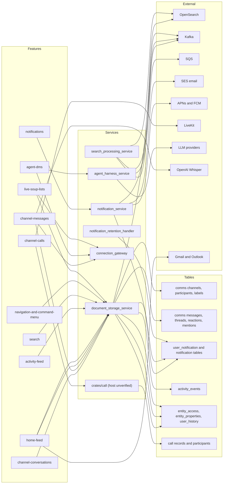

# Communication feature graph

Maps each communication feature in `docs/convex/feature-map/communication/` to its frontend directories, API surface, Rust services, Postgres tables, realtime path, external systems, and Convex v1 scope. Facts come from the code and `docs/agent-guide`; anything not seen directly is marked `(unverified)`.

| Feature | Frontend (apps/web/src/...) | API calls | Rust service(s) | Main Postgres tables | Realtime | External systems | Convex v1 scope |
| --- | --- | --- | --- | --- | --- | --- | --- |
| channel-conversations | features/channel, features/channels-view, features/channel-invitations, features/block-channel, lib/split-router | SDK `channels` (packages/sdk/src/entities/channels); HTTP `/channels` (create, DM and private get-or-create, participants, join, leave, join-link, join/{code}, profile_picture), `/comms/channels` list | document_storage_service (crates/channels, crates/channel_labels) | comms_channels, comms_channel_participants, channel_label, channel_label_channel | connection_gateway (crates/channels connection_gateway_realtime) | SES (invite email to non-users) | v1 |
| channel-messages | features/channel, features/block-channel, features/chat | SDK `messages` (packages/sdk/src/entities/messages); HTTP `/messages/{parent_type}/{parent_id}` (items, threads, timeline, typing, reactions, legacy) | document_storage_service (crates/messages, crates/channels mentions) | comms_messages, comms_message_threads, comms_reactions, comms_entity_mentions, comms_attachments, comms_activity | connection_gateway (crates/messages connection_gateway outbound; typing) | OpenAI Whisper for dictation (crates/dictation) | v1 |
| agent-dms | features/channel, features/block-channel | SDK `agent-sessions`, `agents`, `harnesses`; HTTP `/channels/{id}/bots` (frontend call, route unverified) | agent_harness_service, agent_trigger_service (crates/agent_session, agent_session_realtime, agent_harness) | comms_channel_agents, comms_channels; agent session tables (unverified) | connection_gateway (agent_session_realtime) | LLM providers (crates/anthropic, crates/ai_engine); Kafka `macro.agent_session_lifecycle` | later |
| channel-calls | features/channel (call panel and Calls tab; sub-directory unverified) | SDK `calls` (packages/sdk/src/entities/calls); HTTP crates/call routes: `/active`, `/join/{token}/leave`, `/meetings/prepare`, `/ring-status/{call_id}`, `/webhook`, `/{room_name}/transcript` (mount service unverified) | crates/call; services/transcription (unverified) | call_records, call_meetings, call_participants, call_record_transcripts, call_record_participants, call_entities | connection_gateway for ring and status (unverified); LiveKit media | LiveKit; transcription; Kafka `macro.calls` | later |
| home-feed | features/home, features/soup, features/next-soup (desktop Signal) | SDK `notifications`, `activity`; GraphQL `user.workFeed` and `workFeedUpdates` subscription; REST `/notifications` | document_storage_service (crates/graphql_work_feed, crates/work_feed, crates/graphql_soup); notification_service | user_notification, comms_channel_participants, entity_access, entity_properties, user_history, activity_events | GraphQL subscriptions `/soup/graphql/ws` | Gmail and Outlook for email rows (via email integration) | v1 |
| notifications | features/notifications, features/next-soup (notification actions), settings | SDK `notifications` (packages/sdk/src/entities/notifications); HTTP `/notifications` (user_notifications, v2 bulk seen/done/undone, preferences, device register and unregister) | notification_service (crates/notification); notification_retention_handler | notification, user_notification, notification_user_device_registration, notification_message_receipt, user_notification_type_preference, user_notification_item_unsubscribe, user_mute_notification, channel_notification_email_sent, notification_email_unsubscribe | connection_gateway (new-notification event); Kafka `macro.notifications` | APNs and FCM (push, crates/notification mobile); SES (email, crates/notification email); OS notification APIs (native app) | v1 |
| activity-feed | features/activity | SDK `activity` (packages/sdk/src/entities/activity); GraphQL `user.activity` (team scope); HTTP `/channels/activity` | document_storage_service (crates/activity, crates/graphql_activity) | activity_events, entity_access, team_user | connection_gateway refresh after recorded actions (unverified) | none | v1 |
| search | features/command (search queries in queries/entity-search); route `/app/search` | SDK `search` (packages/sdk/src/entities/search.ts); HTTP `/search`, `/search/simple`, `/search/channel`, `/search/name` | search_service (crates/search_service, crates/models_search); search_processing_service; search_upload_handler | Postgres for name search (tables per query, unverified) | none | OpenSearch (full text); Kafka `macro.calls` and `macro.agent_session_lifecycle`; SQS backfill workers | v1 |
| navigation-and-command-menu | lib/split-router; features/command; features/favorites | SDK `favorites` (packages/sdk/src/entities/favorites); GraphQL entity search cache | document_storage_service (crates/favorites, unverified mount) | favorites (table name unverified) | none | none | v1 |
| live-soup-lists | features/soup, features/next-soup (flat and grouped lists, Done and Undo) | GraphQL Soup queries and mutations (crates/graphql_soup, crates/soup); `/soup/graphql/ws` subscriptions | document_storage_service (crates/graphql_soup, crates/soup, crates/soup_realtime, crates/predicate_index) | entity_access, entity_properties, user_history, comms_channel_participants, user_notification (predicate facts), soup projection tables | GraphQL subscriptions `/soup/graphql/ws`; connection_gateway for entity updates | none | v1 |

Counts: v1 = 8, v1-integration = 0, later = 2 (agent-dms, channel-calls), drop? = 0.

## Convex porting notes

- Soup and the work feed are the largest port. The frontend reads GraphQL shapes, the server keeps a predicate index and projection tables, and the client cache has a per-viewer budget (256 facts per entity). Keep the GraphQL contract, or port the list to Convex queries with the same filters and sort keys before rebuilding the client cache.
- Realtime: channel messages, notifications, and activity currently fan out through connection_gateway (WebSocket connections tracked in DynamoDB). Convex reactive queries can replace this for v1, but each feature's frontend subscription (including `/soup/graphql/ws`) must be reimplemented, not just the data.
- Message rows are probably small enough for Convex documents (row size unverified). Attachments and channel pictures are blobs; keep them out of rows above 1 MiB and store them in object storage (storage location unverified).
- Activity events and notifications grow without bound. The notification retention handler prunes them; port that as a scheduled Convex job, and keep team activity paging bounded.
- Search: today it is OpenSearch fed by Kafka and SQS backfills. Convex full-text search is accepted for v1, but name search for People and All needs fuzzy one- and two-character prefix matching, and index limits must be checked (unverified).
- Long-running work goes to an external worker: agent turns (agent_harness_service), call transcription, and the Whisper dictation call. Convex actions can start them but should not run them.
- Notification delivery (SES email, APNs and FCM push) runs in notification_service; email digests and push need an outbound worker outside Convex if Convex cannot reach those providers directly.
- Mark done and Undo rely on acknowledged notification IDs and server receipts; port these as idempotent mutations with the same receipt shape, or the frontend's Undo and Redo fences break.
- Slack import is a bulk sync: port as a workflow, not a request handler (later scope).

## Open questions

- Calls: is `channel-calls` in this domain, or in the calls domain described by the agent guide's calls page? Scope is `later` here until confirmed.
- Email rows appear in Home (Signal) and in Search's Email category. Confirm that Gmail and Outlook are required for these views in v1, or hide those rows.
- Push (APNs, FCM) and native OS notifications: keep in v1 or move to later? Three users may not need mobile push.
- Agent DMs: confirm they stay `later`. They need the agent harness and LLM providers, which are outside the v1 integration list.
- `services/websocket-service` contains only a Bun echo server on port 6969 in its source; confirm it is unused by communication features before dropping it.
- The mount point for crates/call routes, and for crates/favorites, could not be confirmed from the code read here.
- The favorites table name and the activity REST mount (`/channels/activity` vs `/comms/activity`) need confirmation.
- Whether the settings page for notifications has a direct path (the agent guide does not list one).
