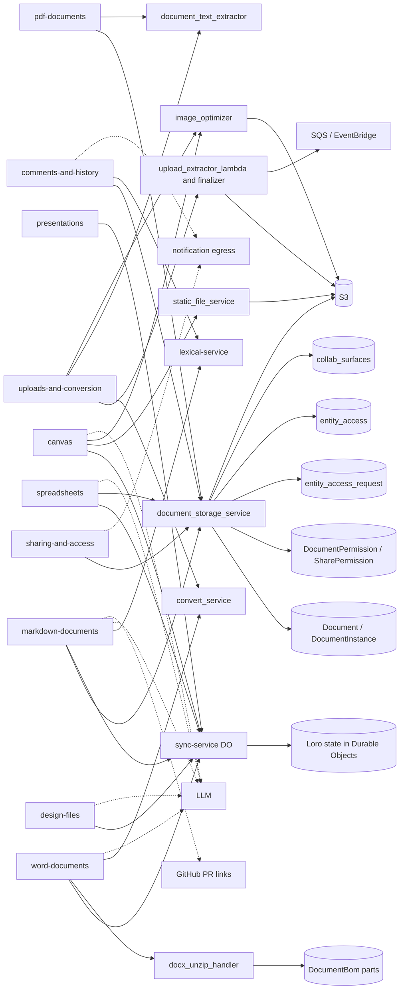

# Documents feature graph

One row per feature in `docs/convex/feature-map/documents/`. Paths are relative to the repo root. "unverified" marks an inference not read in code or the agent guide.

| Feature | Frontend (apps/web/src/features/...) | API calls (SDK entity and/or HTTP) | Rust service(s) | Main Postgres tables | Realtime | External systems | Convex v1 scope |
| --- | --- | --- | --- | --- | --- | --- | --- |
| markdown-documents | `block-md`, `property`, `entity`; `packages/lexical-core` | SDK `entities/documents/document.ts`, `comment.ts`, `anchor.ts`, `version.ts`; `GET/PUT /documents/{id}/...` on document_storage; `/document/{id}/connect` (sync-service) | `document_storage_service`, `sync-service` (Worker + Durable Object), `lexical-service` (text and markdown conversion) | `Document`, `DocumentInstance`, `DocumentPermission`, `collab_surfaces` | Loro CRDT over sync-service WebSocket | LLM (AI edit, Ask Macro); CRM, GitHub PR link unfurl (GitHub: v1-integration sub-feature) | v1 |
| spreadsheets | `block-spreadsheet`; `packages/spreadsheet`, `packages/loro-mirror` | SDK `entities/documents/document.ts` (workbook endpoints unverified); `/documents/{id}/export` (document_storage) | `document_storage_service`, `sync-service`; the grid engine in `packages/spreadsheet` runs in the browser (backend engine unverified) | `Document`, `DocumentInstance`, `DocumentPermission` (workbook body stored as Loro state, unverified) | Loro CRDT over sync-service | S3 (images, imports), LLM (Ask Macro, EditSpreadsheet tools) | later |
| canvas | `block-canvas`; `packages/collaboration`, `packages/loro-mirror` | SDK `entities/documents/document.ts`; presigned URLs for images; `/static-file` upload | `document_storage_service`, `sync-service`, `static_file_service`, `image_optimizer` | `Document`, `DocumentInstance`, `DocumentPermission`, `collab_surfaces` | Loro CRDT over sync-service; live cursors and AI writer previews | S3 (media), LLM (ReadCanvas, EditCanvas, RenderCanvas) | v1 |
| word-documents | `block-write` | SDK `entities/documents/document.ts`, `comment.ts`; `/documents/{id}/export` (409 while parts are missing) | `document_storage_service`, `sync-service`, `docx_unzip_handler` (unzip and parts), `convert_service` (`/docx`), `docx_engine` (in browser) | `Document`, `DocumentInstance`, `DocumentBom`, `DocumentBomPart` (DOCX parts, inferred from names) | Loro CRDT over sync-service | S3 (stored upload, download), LLM (ReadWordDocument, EditWordDocument, CommentOnText) | v1 |
| pdf-documents | `block-pdf` | presigned download URL; `/documents/{id}/location`; SDK `entities/documents/document.ts` | `document_storage_service`, `document_text_extractor` (PDF text for search), `static_file_service` | `Document`, `DocumentInstance` | WebSocket (page and notification events, unverified) | S3 (PDF storage) | v1 |
| presentations | `block-pptx` | SDK `entities/documents/document.ts`; presigned URLs | `document_storage_service`, `sync-service`; `pptx_engine` (in browser) | `Document`, `DocumentInstance` | Loro CRDT over sync-service | S3 (media, stored upload), LLM (EditPresentation) | later |
| design-files | `block-fig`, `block-psd` (Illustrator path unverified) | presigned URLs; SDK `entities/documents/document.ts` | `document_storage_service`, `sync-service`; `fig_engine`, `psd_engine`, `ai_engine` (in browser); `psd_engine` and `ai_engine` also read on the backend for AI tools | `Document`, `DocumentInstance` | Loro CRDT over sync-service (editor sessions) | S3 (design files, previews), LLM (ReadPhotoshopDocument, ReadIllustratorDocument) | later |
| sharing-and-access | `sharing`, `access-requests` | SDK `entities/sharing/access.ts` (`accessRequestsState`, `accessRequestsSubmit`, review and grant), `entities/sharing/permissions.ts`; `/documents/{id}/permissions`; `/validate` and `/permissions_token` | `document_storage_service` (+ `crates/access_requests`, `crates/entity_access`, `crates/share_permission_db_utils`), `crates/notification` (grant and request notifications) | `entity_access`, `entity_access_request`, `entity_access_request_event`, `SharePermission`, `DocumentPermission`, `ChannelSharePermission` (channel grants, shared table) | WebSocket (grant and revoke updates to open documents) | Notification egress (email and push, unverified); team and meeting links read calendar data (calendar domain) | v1 |
| comments-and-history | `block-md` (Discussion), `block-write`, `block-spreadsheet` (comments), `block-pptx` (Review); history overlay location (unverified) | SDK `entities/documents/comment.ts`; `document_storage_service` `/threads` and `/history`; `lexical-service` `comment-mark` and `comment-only-change` | `document_storage_service`, `lexical-service`, `notification` | `Document`, `DocumentInstance`, comment threads (`comms_*` tables shared, unverified), `UserHistory` (unverified for history) | WebSocket for thread updates (unverified) | Notifications on @mention | v1 |
| uploads-and-conversion | `block-unknown`, `block-image`, `block-video`; desktop Finder drop in `apps/web` (not in features) | `document_storage_service` upload and finalize flow (unverified endpoints); `/static_file` upload (path unverified) | `upload_extractor_lambda_handler` (folder zip, Lambda), `document_upload_finalizer_handler` (type detection, legacy conversion), `convert_service` (`/convert`, `/convert/docs`), `document_text_extractor`, `image_optimizer` | `Document`, `DocumentInstance`, `DocumentBom` (unverified for uploads) | None (upload progress polled) | S3 (raw upload), SQS and EventBridge (finalize trigger), LocalStack in dev | v1 |

Counts: v1 = 7, v1-integration = 0, later = 3, drop? = 0.

## Convex porting notes

- Binary blobs: DOCX, PPTX, PSD, AI, Figma and PDF files live in S3 and are read with presigned URLs. Convex rows cannot hold them; use Convex file storage or keep S3 and store only the key (more than 1 MiB per row is not an option).
- Realtime CRDT: markdown, canvas, DOCX, PPTX, design and spreadsheet editors all sync through sync-service Durable Objects using Loro. Convex has no equivalent room; the port needs a decision on a Loro sync host, or on a Convex-backed snapshot and update log with a separate socket. This is the largest risk.
- Engines run in the browser as WASM (`docx_engine`, `pptx_engine`, `fig_engine`, `psd_engine`, `ai_engine`). The backend only reads stored files and AI tool calls, so these engines do not need a Convex port, but the backend read path for `psd_engine` and `ai_engine` does.
- Folder upload (`upload_extractor_lambda_handler`), legacy conversion (`convert_service`) and text extraction (`document_text_extractor`) are long-running; move them to an external worker or a Convex action with a retry, not an inline mutation.
- Permissions: `entity_access` and access-request tables are shared with other domains (calendar, channels, projects). Port them as one permission model, or the v1 sharing rows break.
- Search: text extraction feeds search; the OpenSearch path is used by document_storage_service (unverified for documents specifically). Scope it with the search domain.
- Bulk sync: the sync-service read path that loads a full document is bulk; plan it as a workflow, not a request.

## Open questions

- Who owns the Loro sync host after the port? Options: keep sync-service as the single external realtime component for all editors, or move it into a Convex-hosted service.
- Spreadsheets, presentations and design files are behind PostHog flags (`enable-spreadsheets`, `enable-pptx-editor`, `enable-fig-viewer`, `enable-psd-editor`, `enable-ai-editor`). Confirm whether they are v1 or later.
- `document_email` links (email attachments saved as documents) live in the email domain (`services/email_service`). Assign them to that domain's graph; they are not in this file.
- Is `DocumentBom` the DOCX part table? The name comes from code, not from the agent guide.
- Comment threads: confirm whether they use the shared `comms_*` tables or a documents-only table; the grep result is ambiguous.
- History: the agent guide shows a timeline and fork, but the table behind it is unverified.
- AI tools (ReadCanvas, EditWordDocument and others) are part of the document features. Confirm whether AI is in v1 or in its own domain.
