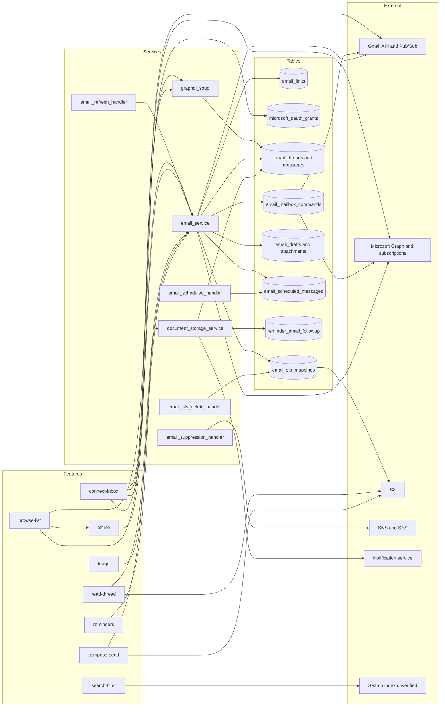

# Email feature graph

One row per feature file in `docs/convex/feature-map/email/`. Scope counts: `v1-integration` 7, `later` 1, `v1` 0, `drop?` 0.

| Feature | Frontend (apps/web/src/...) | API calls (SDK entity or HTTP) | Rust service(s) | Main Postgres tables | Realtime | External systems | Convex v1 scope |
| --- | --- | --- | --- | --- | --- | --- | --- |
| connect-inbox | features/inbox; features/settings/Email.tsx; features/email-view/components/EmptyState | sdk email: `/email/links`, `/email/links/{link_id}/resync`, `/email/links/health-check`, `/email/init`; OAuth callbacks (unverified paths) | services/email_service (`/gmail/webhook`, `/outlook/webhook/{attempt}`, email api); services/email_refresh_handler; crates gmail_client, email_api_client, email, fusionauth (microsoft and google modules) | email_links, email_link_google_scopes, email_link_microsoft_scopes, microsoft_oauth_grants, email_provider_subscriptions, email_gmail_histories, email_sync_streams, email_backfill_jobs | none found (unverified) | Gmail API; Gmail Pub/Sub push; Microsoft Graph; Microsoft Graph subscriptions; FusionAuth; KMS (Microsoft refresh tokens) | v1-integration |
| browse-list | features/email-view (queries, components); features/next-soup/soup-view (email tabs); features/block-email | GraphQL soup (graphql_soup, graphql_email); sdk email: `/email/threads/previews/cursor/{view}`, `/email/labels`, `/email/links` | services/email_service (threads, labels, settings, sync); crates email, graphql_soup, graphql_email | email_threads, email_messages, email_message_labels, email_labels, email_message_recipients, email_thread_client_ids, email_contacts | Soup realtime hydration (channel unverified; websocket-service likely) | Gmail API; Microsoft Graph | v1-integration |
| search-filter | features/email-view/queries (email-search, email-query); @service-search client | search query client (unverified endpoint); soup filter inputs | search backend (unverified; services/search_processing_service indexes); crates graphql_soup_filter_input | email_contact_search_index; search index (unverified) | none | search index (unverified; OpenSearch not confirmed); Gmail and Outlook via sync | v1-integration |
| read-thread | features/email-thread; features/email-message; features/block-email | sdk email: `/email/threads/{thread_id}`, `/email/threads/{id}/messages`, `/email/messages/{id}`, `/email/attachments/{id}`, `/email/attachments/{id}/document_id`, `/email/threads/{thread_id}/calendar-invitations` | services/email_service (attachments, calendar invitations); crates email (attachment_access, calendar_invitation_parser), email_api_client | email_messages, email_attachments, email_attachment_blobs, email_sfs_mappings, email_message_calendar_invites, email_attachments_macro | none | S3 (attachment storage via SFS); Gmail API attachments; Microsoft Graph attachments | v1-integration |
| triage | features/email-view; features/email-thread; features/next-soup/actions | sdk email: `/email/threads/{id}/state`, `/email/threads/{id}/archived`, `/email/threads/{id}/seen`, `/email/threads/{id}/labels`, `/email/threads/{id}/operations`, `/email/messages/labels`, `/email/messages/batch`; setEmailThreadArchived (GraphQL) | services/email_service (threads, labels, operations); crates email (mailbox commands, projection) | email_mailbox_commands, email_mailbox_command_targets, email_projection_outbox, email_message_labels, email_labels, email_threads | soup realtime (channel unverified) | Gmail labels API; Microsoft Graph message updates | v1-integration |
| compose-send | features/email-compose (164 files); features/block-email | sdk email: `/email/drafts`, `/email/drafts/{id}`, `/email/drafts/{id}/attachments`, `/email/drafts/{id}/forwarded-attachments`, `/email/drafts/{id}/operation`, `/email/drafts/{id}/resolve`, `/email/drafts/{id}/transfer`, `/email/draft-transfers/{id}/recover`, `/email/drafts/scheduled`, `/email/drafts/scheduled/{id}`; GraphQL draft queue | services/email_service (drafts, scheduled delivery, draft attachment storage, forwarded attachments); services/email_scheduled_handler; services/email_sfs_delete_handler; services/email_suppression_handler; crates email (drafts, scheduled_delivery, send_attempt), gmail_client (messages send), email_api_client (outlook drafts send) | email_mailbox_drafts, email_draft_transfers, email_draft_client_ids, email_draft_object_cleanup, email_attachments_drafts, email_attachments_fwd, email_scheduled_messages, email_send_attempts, email_sfs_mappings | soup realtime; draft sync via GraphQL queue | Gmail send; Microsoft Graph send; S3 (draft attachments); SNS and SES bounce feed (relation to user-sent mail unverified) | v1-integration |
| reminders | features/reminders; features/email-view/queries (use-reminder-email-source); features/email-view (reminder menu) | document storage REST: `/dss/reminders/email/{threadId}` (GET, PUT); email collection list (reminders router) | services/document_storage_service (reminders router; EmailReminderDispatch sweep); crates reminders (email_followup, email_collection), email (inbox return) | reminder, reminder_occurrence, reminder_email_followup, reminder_email_operation, email_threads | Home notifications; reminder collection refresh on tab return | notification service; mobile push (provider unverified); Gmail and Outlook (inbox return and reply detection) | v1-integration |
| offline | features/email-view (cache, queries); native Tauri cache; features/email-compose (queued sends) | GraphQL soup and mutation queue; `setEmailThreadArchived`; REST fallback (sdk email) | services/email_service (previews); crates graphql_soup, graphql_email | email_threads and email_messages via previews; device-local IndexedDB and native cache (not in Postgres) | GraphQL websocket subscriptions (`/soup/graphql/ws`) | none beyond the sync sources | later |

## Mermaid

## Convex porting notes

- Gmail sync is push-driven. The Pub/Sub webhook looks up the link and queues a history-based sync (history ID stored in `email_gmail_histories`). In Convex, the webhook becomes an HTTP action that enqueues a per-link workflow; no direct sync work in the handler.
- Gmail watch renewal runs from a sweep that refreshes active links in hourly buckets. Convert to a per-link durable timer that renews before watch expiry (expiry length (unverified; confirm in the Gmail watch client)).
- Outlook sync uses Graph subscriptions plus per-folder delta queries with stored checkpoints. The webhook answers the validation handshake and handles missed, removed, and reauthorization lifecycle events. Model delta paging and subscription recovery as one workflow per mailbox with retries and checkpoints.
- Initial and ongoing backfill is bulk: Gmail lists up to 500 threads or messages per page, and backfill outboxes run in batches of 50. A large mailbox is thousands of steps. Put it in a workflow with checkpointed progress, not one long action.
- Attachments and bodies exceed the 1 MiB row guidance. Keep bytes in S3 (through the existing SFS mappings) and store only references in Convex. Draft attachments are capped at 18 MB (Gmail) and 25 MB (Outlook) per send in the product rules.
- OAuth refresh tokens: Microsoft tokens are KMS-encrypted in `microsoft_oauth_grants` (ciphertext, wrapped data key, nonce, KMS key id). Gmail refresh-token storage was not located in this pass (unverified). Convex needs the same encryption boundary and KMS access, or the tokens stay in Postgres behind a service.
- Sending must be idempotent. Send attempts are recorded per attempt ID; a Convex action that retries must not resend. Gmail sends via messages.send; Outlook via draft then send.
- Scheduled send and reminders depend on a once-a-minute sweep (reminder dispatch) and a scheduled-message recovery scan. Use Convex scheduled functions with idempotent dispatch keyed on the reminder or message ID.
- Search is not confirmed in this repo's email code path (unverified backend). Decide between Convex search and the existing search service before porting.
- Realtime: email changes reach open clients through soup hydration; the channel was not confirmed. No Loro CRDT is used for email bodies.
- Gmail and Outlook differ in the hard parts: Gmail uses push plus history IDs, Outlook uses subscriptions plus delta checkpoints. Keep a provider adapter boundary so both fit the same Convex workflow shape.

## Open questions

- Where do Gmail OAuth refresh tokens live: FusionAuth, Postgres, or both? Google grants are handled in crates/fusionauth but storage was not confirmed.
- Is search a v1 core feature or part of the email integration? Current row says v1-integration.
- Should email reminders stay v1-integration (depends on email) or move with the reminders core?
- Does `email_suppression_handler` (SNS and SES bounce feed) cover user-sent mail, or only transactional notifications? Impacts whether it ports with email.
- Confirm the Gmail watch expiry and the Outlook subscription lifetime, and whether the renewal cadence can be per link.
- Confirm the free inbox limit (FREE_INBOX_LIMIT is 2 in code) is a product rule for v1.
- Offline mail is marked later; confirm three users do not need offline reads.
- Confirm the mobile push provider for `Reminder:` notifications.
- Calendar invitation handling inside mail is owned by the calendar domain; confirm the boundary before scoping.
