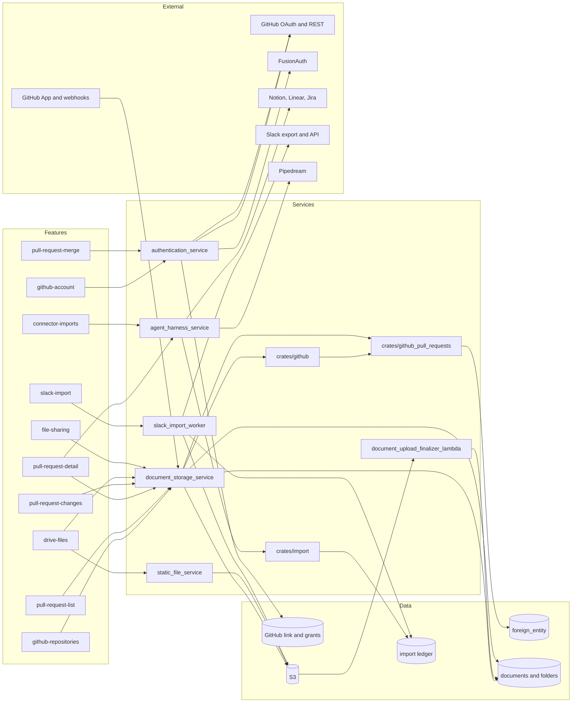

# Integrations feature graph

Covers GitHub (account link, App install and webhook sync, pull requests, reviews, merge), Drive files and file sharing, connector imports, and Slack archive import. Feature files live in [feature-map/integrations](../feature-map/integrations/).

| Feature | Frontend | API calls | Rust service(s) | Main Postgres tables | Realtime | External systems | Convex v1 scope |
| --- | --- | --- | --- | --- | --- | --- | --- |
| [github-account](../feature-map/integrations/github-account.md) | `apps/web/src/features/settings/GitHub.tsx`, `@queries/auth` GitHub link queries, `features/auth/GithubReauthenticationPrompt.tsx` | `GET /link/github/status`, `/link/github` (HTTP methods for init, delete and reauth unverified) | `authentication_service` (`api/link/github.rs`); `crates/github` link feature | GitHub link and grant rows (names unverified) | none | GitHub OAuth; FusionAuth (grants/identities) | v1-integration |
| [github-repositories](../feature-map/integrations/github-repositories.md) | `features/reviews-view/components/RepositoriesPromotion.tsx`; sidebar promotion card | `GET /github/install-sync` (redirect), `GET /github/sync-redirect`, `POST /github/webhook` | `document_storage_service` (mounts `crates/github` sync router at `/github`); `crates/github` | installation and sync state (names unverified) | none | GitHub App install page; GitHub App webhooks (HMAC-verified) | v1-integration |
| [pull-request-list](../feature-map/integrations/pull-request-list.md) | `apps/web/src/features/reviews-view/` (list, board, filters, status tabs) | Soup items via `storageServiceClient.getSoupAstItems`; `getGithubPullRequestFacets`; mergeability query | `document_storage_service` (soup, `/github_pull_requests` router); `crates/github_pull_requests` (`service::index`) | `foreign_entity` (generic) with typed PR columns | Soup GraphQL subscription (`soup_realtime`); PR update events via `github_pull_requests/broker.rs` | GitHub (data source) | v1-integration |
| [pull-request-detail](../feature-map/integrations/pull-request-detail.md) | `apps/web/src/features/block-pr/` (`views/PrDetail.tsx`, `component/Block.tsx`, `side-panel/`) | `getGithubPullRequest`; `getGithubPullRequestTasks`; `sessionsForPullRequests` (agent harness); `GET` PR discussion (path unverified) | `document_storage_service`; `agent_harness_service` (session links) | `foreign_entity`; agent session links | none (discussion and diff requests are separate) | GitHub | v1-integration |
| [pull-request-changes](../feature-map/integrations/pull-request-changes.md) | `block-pr/component/PrChanges.tsx`, `block-pr/data/pr-changes.ts` | `getGithubPullRequestChanges` (`StoredGithubPullRequest` changeset DTO) | `document_storage_service`; `crates/github_pull_requests` (`service::changes`); `crates/git_patch` | `foreign_entity` (changeset metadata) | none | GitHub; S3 (diff/patch store, `s3_patch_store.rs`) | v1-integration |
| [pull-request-merge](../feature-map/integrations/pull-request-merge.md) | `block-pr/component/MergePullRequestButton.tsx`, `block-pr/primitives/create-merge-pull-request-action.ts`, `@queries/storage/pr-merge` | `POST /github_pull_requests/merge` | `authentication_service` (`api/github_pull_requests.rs`) with the user's linked GitHub account | `foreign_entity` (refreshed row) | Soup update after refresh | GitHub merge API (acts as the signed-in user) | v1-integration |
| [drive-files](../feature-map/integrations/drive-files.md) | `apps/web/src/features/drive-view/` (views, filters, folder composer, detail navigation) | Documents SDK (`createUpload`, save/commit); folder and document calls via storage client; GraphQL soup mutations behind `enable-graphql-soup` | `document_storage_service`; `static_file_service` (upload and serve, per its AGENTS.md); `document_upload_finalizer_handler`; `upload_extractor_lambda_handler`; `dataloss_prevention_handler` (purpose unverified) | documents, folders, items, trash markers (names unverified) | Soup GraphQL subscription and cache | S3 (presigned uploads); EventBridge/SQS to Lambda (finalizer) | v1 |
| [file-sharing](../feature-map/integrations/file-sharing.md) | `apps/web/src/features/sharing/global-share-modal/`, `sharing/native-share-sheet/`, drive share dialogs | SDK `packages/sdk/src/entities/sharing/access.ts` (`EntityAccess`, access requests); storage share-policy mutations | `document_storage_service`; entity access service (`crates/entity_access`) | entity access and access-request rows (names unverified) | none | none | v1 (file and folder aspects only) |
| [connector-imports](../feature-map/integrations/connector-imports.md) | `apps/web/src/features/connector-import/`, `integrations/import-linear/ImportLinear.tsx`, `integrations/mcp-setup/` | agent tools `ImportFromNotion`, `ImportFromLinear`, `ImportFromJira`, `DecideReview`; Pipedream connect; GitHub MCP (`api.githubcopilot.com/mcp`) | `agent_harness_service`; `crates/import` (ledger); `crates/import_notion`, `crates/import_linear`, `crates/import_jira`, `crates/import_tracker` | `ImportEntity` ledger and review rows (per `crates/import/AGENTS.md`) | agent chat stream | Notion, Linear, Jira, GitHub issues, Pipedream connectors, GitHub MCP | later |
| [slack-import](../feature-map/integrations/slack-import.md) | `apps/web/src/features/slack-import/`, `settings/TeamConnections.tsx`, chat Slack card | `/slack/imports`, `/slack-import/keys`, upload (presigned) and `/uploads/complete`; job polling | `slack_import_worker`; `crates/import`; `crates/slack_integration` | import ledger, imported channels, messages (names unverified) | job polling; websocket reconnect keeps polling | Slack export ZIP; Slack API / Pipedream Slack connection; S3 | later |

## Cross-cutting backend pieces

| Service or crate | Role for this domain | Scope |
| --- | --- | --- |
| `crates/webhook` | Macro's own outbound webhooks (customer endpoints, Kafka ingestion, SQS delivery). It is not the GitHub inbound webhook. | later (not in Reviews or the GitHub integration) |
| `crates/github` `github_sync_router` | Receives GitHub App webhooks and runs the App install redirect and callback | v1-integration |
| `services/unfurl_service`, `services/image_proxy_service` | Link previews and SSRF-guarded image proxy for pasted URLs and remote images; used by documents, chat and email | v1 (shared, owned by the documents and email domains) |
| `services/static_file_service` | Attachment upload, storage and serve (DynamoDB metadata, S3 bytes, presigned URLs) | v1 |
| `services/dataloss_prevention_handler` | S3-event Lambda that publishes to SNS (purpose beyond that unverified) | unclear (see open questions) |

## Mermaid

## Convex porting notes

- **GitHub auth is two systems.** The account link is OAuth with a FusionAuth grant that must be refreshed and reassigned when a grant owner disappears; repository sync is a GitHub App installation with webhooks. Port the App credentials and installation tokens (cached by identity and GitHub account) as their own Convex action, and keep the OAuth grant flow in the auth layer. The `crates/github` AGENTS.md lists lock-timeout and grant-replacement gotchas that the rebuild must preserve.
- **Webhook wiring.** `POST /github/webhook` verifies the signature with constant-time comparison. An HTTP action in Convex must verify the same way before touching data; the 403 mapping deliberately hides whether an App is installed.
- **Do not confuse `crates/webhook`.** It is Macro's outbound webhook product, not GitHub ingestion. Nothing in the integrations v1 scope needs it.
- **PR rows and bulk sync.** PRs are foreign entities with typed columns. A full sync of many repositories exceeds the 16,000-row transaction limit; run it as a workflow over cursors with a workpool, as the root index states.
- **Diffs are large.** Changeset patches sit in S3 today. Keep them in Convex file storage, not in rows (1 MiB limit per row).
- **Realtime.** Reviews rows update through the Soup GraphQL subscription. The Convex replacement needs a subscription per list query, and an unchanged webhook must not produce a Soup update.
- **Drive uploads.** Presigned S3 upload, then a finalizer that resolves file type and initializes Markdown. Convex file storage can replace the presigned flow; the finalizer becomes an action scheduled after upload.
- **Connector imports and Slack ZIPs are long-running.** Import review and approval are workflow steps; Slack ZIP parsing and progress belong in the external import worker. The client keeps staged history in IndexedDB; a Convex port must preserve the ordering, dedupe and byte-limit checks.
- **Search and merge.** PR and Drive search use the Soup and filter engines. Convex full-text and vector search cover the text part; facets need explicit indexes.

## Open questions

- Which Convex table names replace `foreign_entity` for PRs, and whether PR typed columns stay as fields on one table.
- Where the GitHub App private key and installation tokens live (Convex env or the auth layer), and who refreshes installation tokens.
- Whether `dataloss_prevention_handler` (S3 event to SNS) belongs to this domain at all; its handler only publishes to SNS in the code read.
- Whether the Macro MCP setup modal (`integrations/mcp-setup`) is in v1 or later; it is not in any feature file yet.
- Exact Drive sharing labels, channel sharing for Drive files, and the link-sharing card (unverified in this pass).
- Whether GitHub connector task import (Tasks → GitHub) is `later` as proposed here; it uses the native GitHub MCP, not the PR integration.
- Exact route and table names for GitHub link delete and reauthentication (not read in detail).
