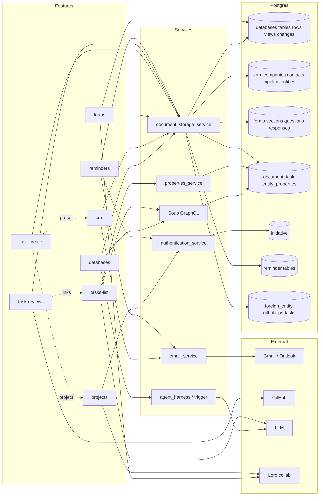

# Work feature graph

Covers databases, CRM (Customers), forms, tasks (list, create, Reviews), projects, and email reminders. Source: `apps/web/src/features/` (database, database-query, block-database, crm, block-company, block-contact, block-pipeline, block-form, projects, block-project, block-initiative, tasks-view, task-composer, reminders) plus `apps/web/src/components/{kanban,list,gantt}`, the SDK entities in `packages/sdk/src/entities/`, and the agent guides in `docs/agent-guide/`. Backend crates were located by their dependents in `services/*/Cargo.toml`; HTTP paths are only those named in the agent guides or seen in web code. Anything not seen directly is marked `(unverified)`.

| Feature | Frontend (apps/web/src/...) | API calls | Rust service(s) | Main Postgres tables | Realtime | External systems | Convex v1 scope |
| --- | --- | --- | --- | --- | --- | --- | --- |
| databases | features/database, features/database-query, features/block-database, components/kanban, components/list | SDK `databases/{database,table,row,column,view,query,webhook}`; `POST /databases/{id}/ops` (typed ops, journal, undo); `POST /databases/query`; reads via Soup GraphQL `/items/soup/graphql`; `POST /databases/{id}/changes/{change}/undo` | document_storage_service, agent_harness_service (crates/databases, crates/databases_sql) | databases, database_tables, database_columns, database_rows, database_views, database_view_positions, database_changes (+ _rows/_columns), database_column_protections, database_queries, database_webhooks, database_starter_seeds | Table-changed message through gateway; presence peers (connection_gateway / websocket-service: unverified) | LLM (AI answers, tools); SQL engine runs in browser (wasm) | v1 |
| crm | features/crm, features/block-company, features/block-contact, features/block-pipeline | SDK `crm/{company,contact,pipeline,pipelines,comment}`; `storage.getCompany`, `listCompanyContacts`; CRM HTTP and GraphQL (crates/graphql_crm) | document_storage_service, email_service, authentication_service, agent_harness_service, agent_trigger_service (crates/crm) | crm_companies, crm_contacts, crm_domains, crm_domain_directory, crm_pipeline_entities, crm_comment, crm_thread, crm_contact_sources, crm_cleanup_jobs, team_crm_settings | None (pipelines poll every 5 s) | Gmail/Outlook (Email and Calls tabs via email_service); LLM (AI pipeline tools) | v1 (companies, people, pipelines, CSV); Email/Calls tabs follow v1-integration |
| forms | features/block-form | SDK `forms/{form,question,section,response}`; `/forms/accessible`, `/forms/layout`, `/forms/{id}/collaboration` (web); `CreateForm`, `ReadForm`, `EditForm`, `SetFormAccess`, `ListForms` AI tools | document_storage_service (crates/forms, crates/models_forms) | forms, form_sections, form_questions, form_responses; answers land in a `databases` table | Loro collaborative layout (crates/collab_surface) | Booking/scheduling for the booking step (calendar: unverified); LLM tools | v1 (booking step: later) |
| tasks-list | features/tasks-view, components/list, components/kanban, components/gantt | Soup GraphQL (`GroupSoup`, grouped continuations, cache); `SetEntityProperty`, `UpdateEntityPropertyOptions`, `EntityProperties` GraphQL; property catalogue via properties service; bulk delete via DELETE per item | document_storage_service (Soup: crates/graphql_soup, crates/soup); properties_service (host service: unverified) | document_task, entity_properties, property_definitions, property_options, saved_view, excluded_default_view, team_task, team_task_counter | GraphQL cache; hidden-tab deferral; realtime cache writes (channel: unverified) | LLM (Filter with AI, tasks AI tools) | v1 |
| task-create | features/task-composer, features/tasks-view | `POST /dss/documents/create_task` (tasks are documents); property writes as above; Subtask picks a parent | document_storage_service (crates/documents, crates/system_properties) | document_task, entity_properties, documents | None | Notification on mention (unverified) | v1 |
| task-reviews | features/tasks-view (Reviews shell) | GitHub PR list/detail/refresh endpoints (crates/github_pull_requests, crates/github); board moves call GitHub on the user's behalf | document_storage_service, authentication_service, agent_harness_service (crates/github_pull_requests) | foreign_entity, public.github_pr_tasks, agent_session_review | None (refresh on open) | GitHub (PRs, reviews, merge, draft, labels, checks) | v1-integration |
| projects | features/projects, features/block-project, features/block-initiative | SDK `projects/project` (storage project handler: folder-level, see open questions); initiative endpoints (crates/initiative, crates/graphql_initiative); description via collab surface | document_storage_service, authentication_service (crates/initiative; crates/projects for folder-level) | initiative, initiative_member, task_initiative (projects: folder tables, separate) | Collab surface for description (Loro) | None | v1 |
| reminders | features/reminders (Email Reminders view, Remind-me picker) | `/dss/reminders/email/{threadId}` (GET, PUT); email reminder list via email endpoints | document_storage_service (crates/reminders, dispatch worker) | reminder, reminder_email_followup, reminder_email_operation, reminder_occurrence | Notification delivery; list refresh on tab focus | Gmail/Outlook mailbox (email inbox restoration); push notifications | v1-integration |

## macro CLI dependencies

The `macro` CLI (`~/.agents/skills/macro/cli/macro.ts`, via `@macro-inc/sdk`) must keep working. Endpoints it uses, by SDK call:

- `macro tasks create` → `Task.create` → `POST /dss/documents/create_task` (tasks are documents). Body markdown, project, assignees, priority, status are then set as properties.
- `macro tasks set` → property writes (`SetEntityProperty` / `EntityProperties` GraphQL, properties service: unverified).
- `macro tasks search` → `Task.search` → Soup query (`/items/soup/graphql`).
- `macro tasks for-pr <url>` → `Task.forPullRequest` → GitHub PR index (`foreign_entity`, `github_pr_tasks`); needs the GitHub App installed on the org.
- `macro projects [query]` → `macro.projects.search` / `byId` → SDK `Project` → `storage.getProjectHandler` / `getProjectContentHandler`. This is the folder-level `projects` crate, not the initiative behind the Tasks Projects UI (see open questions).
- `macro members` → `users.me`, `teams.list`, and user lookup (`users.byId`).
- `macro whoami`, `macro url` are client-only.

## Convex porting notes

- Databases: the grid runs its view in the browser over Soup GraphQL, and every edit is a typed ops batch with journaled inverses for undo. Porting risk is the batch/journal contract and the browser SQL engine reading large Soup pages; keep `ops` atomic in one Convex mutation and store inverses per change.
- Databases: view positions and board card order are stored per view; a row write must update positions transactionally.
- Databases: the AI answer path runs a SQL-like query server-side; the database CSV export and webhooks need the same row reads.
- CRM: five-second pipeline polling is cheap in Convex only if queries are subscribed rather than polled; prefer reactive queries.
- CRM: CSV import/export is multi-step and resumable (retry adds only missing rows); run as a Convex action or external worker, not a single mutation.
- Forms: the builder uses Loro CRDT for the layout. Convex has no Loro; either keep a Loro sync service beside Convex or convert to field-level Convex documents with last-writer-wins for layout. This is the biggest realtime decision.
- Forms: responses write rows into a databases table; the write must be atomic with the response ledger row.
- Tasks: Soup grouped lists with continuations and optimistic cache rollback are the hardest read path. Convex reactive queries can replace the cache, but grouped pagination needs a stable cursor.
- Tasks: property writes are optimistic with rollback; keep mutation ids for retry and offline replay.
- Tasks: bulk delete and bulk property edits should be batch mutations with per-item results; the UI expects partial-failure reporting.
- Tasks: search is served by the search service and OpenSearch (unverified for this path); not in Convex scope unless a search index is ported.
- Reviews: depends on GitHub webhook receipt and PR refresh; the refresh and merge/draft actions need an external worker or Convex action with GitHub App tokens.
- Projects: description is a collaborative Markdown surface (Loro); same decision as forms.
- Reminders: dispatch sweeps once a minute; port to a Convex scheduled function (cron), with idempotent delivery keyed by reminder occurrence.
- Reminders: the email inbox restoration crosses into Gmail/Outlook; v1-integration only.
- Long-running jobs: CRM cleanup jobs, tasks dedup embeddings (`task_duplicate_*`), and AI query answers should run as external workers, not inline mutations.
- Search: the Ctrl/Cmd+F search inside a database is in-browser over every table; large databases need a server-side index or this stays client-side with a row cap.

## Open questions

1. Which service hosts the `/databases`, `/forms`, `/crm`, and `/initiatives` HTTP routes? Confirmed only the crate dependents in `services/*/Cargo.toml`.
2. The `macro projects` CLI and SDK `Project` use the folder-level projects endpoints, while the Tasks Projects UI uses the initiative crate (URLs `initiative-view~<id>`). Confirm the CLI's `--project Alpha` means an initiative, or port both.
3. Is the properties service a separate deployable, and which one serves `SetEntityProperty`? (unverified)
4. Which channel carries the database table-changed message and presence: connection gateway or websocket-service? (unverified)
5. Is Reviews (GitHub PRs) in v1-integration, or deferred until the GitHub integration is ported?
6. Forms booking step: is scheduling in v1 or `later`? It depends on the calendar integration.
7. CRM Email and Calls tabs depend on the email integration; confirm they are v1-integration, not v1.
8. Is the `enable-*` PostHog flag set (databases, forms, crm-activity, gantt, projects, tasks-reviews) to be replaced by a Convex config, or dropped for 3 users?
